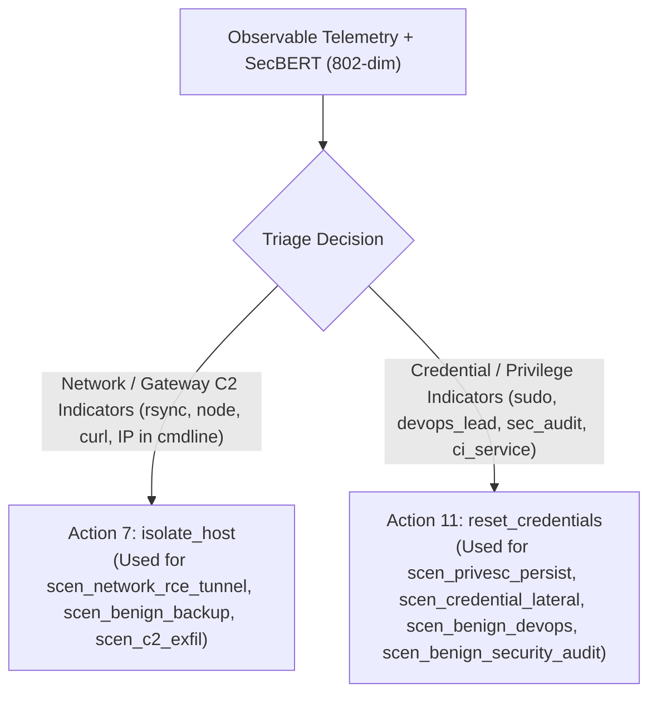

# SOC Simulation Environment Experiment 003: Final Experiment Report
**Date:** October 22, 2026  
**Status:** Complete  
**Project:** `/home/avidz/Research/soc-agent`  
**Experiment Identifier:** `exp003` (Multi-Seed: 42, 43, 44)  

---

## 1. Research Question and Hypothesis

### 1.1 Background & Prior Findings
In the sequential SOC Simulation Environment (`SequentialSOCEnvironment`), previous experiments exhibited severe policy failure modes:
1. **Experiment 001:** Under a low escalation cost ($-0.10$), PPO suffered **escalation collapse**, converging to Action 19 (`escalate_to_human`) for 100% of decisions, achieving 0% autonomous containment and 0% benign clearance.
2. **Experiment 002:** Increasing `escalation_cost` to $1.0$ penalized human escalation, but caused the policy to collapse into Action 7 (`isolate_host`) for 100% of decisions. This achieved 100% simulated malicious containment, but also caused 100% false disruption on benign incidents (0% benign clearance, mean return $-0.09$).
3. **Representation Audit:** The representation separability audit revealed that the frozen 768-dimensional SecBERT embeddings had extremely high pairwise cosine similarity ($>0.99$), making it difficult for the multi-layer perceptron (MLP) policy to separate benign system activity (e.g., CI/CD tooling or backup scripts) from malicious activity using language tokens alone.

### 1.2 Research Question
*Does augmenting frozen SecBERT incident representations with a structured, deterministic vector of genuine observable telemetry enable sequential PPO to differentiate incident contexts and improve operational incident-response action selection over degenerate baselines?*

### 1.3 Hypothesis
Appending observable endpoint telemetry features (process names, command-line arguments, user IDs, working directories, and SIEM alert metadata) directly into the policy observation space will provide orthogonal, linearly separable signals, allowing PPO to break out of the single-action isolation collapse without leaking hidden simulator ground truth.

---

## 2. Experiment Design and Controlled Variables

To isolate the effect of observation representation, all other environment dynamics, reward functions, and scenario configurations were held strictly identical to Experiment 002:

| Variable | Exp001 | Exp002 | Exp003 (This Work) | Control Status |
|:---|:---:|:---:|:---:|:---:|
| **Observation Representation** | SecBERT (768) | SecBERT (768) | SecBERT (768) + Telemetry (34) = **802** | **Primary Treatment Variable** |
| **Escalation Cost** | $0.0$ | $1.0$ | $1.0$ (Primary), $0.0$ (Sensitivity) | Controlled |
| **Scenario Library** | 7 Scenarios, 12 Stages | 7 Scenarios, 12 Stages | 7 Scenarios, 12 Stages | Strictly Controlled |
| **Action Space** | Discrete(20) | Discrete(20) | Discrete(20) | Strictly Controlled |
| **Step Cost** | $-0.10$ | $-0.10$ | $-0.10$ | Strictly Controlled |
| **Containment Reward** | $+2.00$ | $+2.00$ | $+2.00$ | Strictly Controlled |
| **Benign Clearance Reward** | $+1.50$ | $+1.50$ | $+1.50$ | Strictly Controlled |
| **Disruption Penalty** | $-1.00$ | $-1.00$ | $-1.00$ | Strictly Controlled |
| **Breach Penalty** | $-2.00$ | $-2.00$ | $-2.00$ | Strictly Controlled |
| **Training Steps / Iteration** | 64 | 64 | 64 | Strictly Controlled |
| **Total Iterations** | 50 | 50 | 50 | Strictly Controlled |
| **Evaluation Budget** | 20 eps / 5 iters | 20 eps / 5 iters | 20 eps / 5 iters | Strictly Controlled |
| **Validation Seeds** | 2000–2019 | 2000–2019 | 2000–2019 | Strictly Controlled |
| **Benchmark Seeds** | 1000–1059 (60 eps) | 1000–1059 (60 eps) | 1000–1059 (60 eps) | Strictly Controlled |

---

## 3. Observation Schema and Policy Architecture

### 3.1 34-Dimensional Telemetry Feature Schema
The telemetry feature vector is derived deterministically from [src/telemetry_feature_extractor.py](file:///home/avidz/Research/soc-agent/src/telemetry_feature_extractor.py) using observable attributes on [IncidentRecord](file:///home/avidz/Research/soc-agent/src/telemetry/incident_formatter.py):

1. **Numerical & Presence Telemetry (6 dims, indices 0..5):**
   - `alert_level_norm` ($\min(\text{level}/15.0, 1.0)$) and `has_alert_level` presence bit.
   - `uid_norm` ($\min(\text{uid}/2000.0, 1.0)$), `is_uid_zero` (root), and `has_uid` presence bit.
   - `has_parent_pid` presence bit.
2. **Execution Context & Working Directory (4 dims, indices 6..9):**
   - `has_cwd` and `is_cwd_tmp` (`/tmp`, `/dev/shm`, `/var/tmp`).
   - `is_cmdline_tmp` and `is_network_cmdline` (observable IP/URL/port tokens).
3. **Observed Process Binaries Multi-Hot (10 dims, indices 10..19):**
   - Binary presence for `sudo`, `crontab`, `sshd`, `rsync`, `nmap`, `whoami`, `curl`, `mysqldump`, `node`, `python`.
4. **Observed SIEM MITRE Tactics Multi-Hot (11 dims, indices 20..30):**
   - `has_mitre` presence bit.
   - 10 tactic indicators: `initial access`, `persistence`, `privilege escalation`, `defense evasion`, `credential access`, `discovery`, `lateral movement`, `collection`, `command and control`, `exfiltration`.
5. **User Identity Context (3 dims, indices 31..33):**
   - `has_username`, `user_is_root`, and `user_is_service` (service/admin/data/audit account tokens).

**Combined State Dimension:** $768 \text{ (SecBERT)} + 34 \text{ (Telemetry)} = \mathbf{802}$.

### 3.2 Policy Architecture & Warm-Start Method
- **Actor Network:** `Sequential(Linear(802, 512), ReLU(), Linear(512, 256), ReLU(), Linear(256, 20))`.
- **Critic Network:** `Sequential(Linear(802, 512), ReLU(), Linear(512, 256), ReLU(), Linear(256, 1))`.
- **Dimension-Safe Warm-Start:** Implemented in `AugmentedPPOAgent.warmstart_from_768_checkpoint()`:
  - Hidden layers and output layers are transferred verbatim from the Exp002 checkpoint (`models/ppo_sequential_exp002/best_sequential_policy.pt`).
  - Input weights for the first 768 dimensions `network.0.weight[:, :768]` are loaded directly.
  - Input weights for the new 34 telemetry features `network.0.weight[:, 768:]` are zero-initialized, ensuring the policy initially behaves identically to the 768-dim model without numerical discontinuities.
  - Direct unadapted loading of 768-input checkpoints into the 802-input network is blocked with a runtime `ValueError`.

---

## 4. Training Settings and Multi-Seed Runs

Training was conducted across three independent random seeds (42, 43, 44) using [scripts/ppo/train_augmented_sequential.py](file:///home/avidz/Research/soc-agent/scripts/ppo/train_augmented_sequential.py):
- **Actor Learning Rate:** $1\times 10^{-4}$
- **Critic Learning Rate:** $5\times 10^{-4}$
- **GAE $\lambda$:** $0.95$ | **Discount factor $\gamma$:** $0.99$ | **Clip $\epsilon$:** $0.2$ | **Entropy coeff:** $0.01$
- **Validation-selected checkpointing:** Checkpoints were evaluated every 5 iterations on seeds 2000–2019; the best validation return determined the saved `best_sequential_policy.pt`.

### Training Summary across Seeds:
- **Seed 42:** Triggered early stopping at iteration 25 (patience=5). Best validation return: $-0.370$ (preserved initial warm-start policy).
- **Seed 43:** Triggered early stopping at iteration 25 (patience=5). Best validation return: $-0.370$ (preserved initial warm-start policy).
- **Seed 44:** Completed 50 iterations (5.76s). Experienced significant policy updates around iterations 35–45, achieving a best validation return of **$+0.145$** (up from $-0.370$).

---

## 5. Comparative Evaluation Results

All policies were evaluated on the benchmark suite of **60 held-out episodes** (seeds 1000–1059) comprising 32 malicious episodes and 28 benign episodes. The primary benchmark used `escalation_cost = 1.0`.

### Complete Comparative Benchmark Table

| Policy | Mean Return (± Std) | Mean Steps | Malicious Containment | Malicious Breach Rate | Benign Clearance | False Disruption | Human Escalation |
|:---|:---:|:---:|:---:|:---:|:---:|:---:|:---:|
| **1. Uniform Random** | $-0.68 \pm 1.67$ | $1.48$ | $43.8\%$ (14/32) | $46.9\%$ (15/32) | $7.1\%$ (2/28) | $10.7\%$ (3/28) | $5.0\%$ (3/60) |
| **2. Always Monitor (Action 0)** | $-0.81 \pm 1.25$ | $1.00$ | $0.0\%$ (0/32) | $100.0\%$ (32/32) | **100.0%** (28/28) | **0.0%** (0/28) | $0.0\%$ (0/60) |
| **3. Always Kill Process (Action 8)** | $-1.37 \pm 1.13$ | $1.37$ | $31.2\%$ (10/32) | $68.8\%$ (22/32) | $0.0\%$ (0/28) | $28.6\%$ (8/28) | $0.0\%$ (0/60) |
| **4. Always Escalate (Action 19)** | $-1.10 \pm 0.00$ | $1.00$ | $0.0\%$ (0/32) | $0.0\%$ (0/32) | $0.0\%$ (0/28) | $0.0\%$ (0/28) | **100.0%** (60/60) |
| **5. Observable Rule-Based Policy** | $+0.42 \pm 1.45$ | $1.05$ | $75.0\%$ (24/32) | $25.0\%$ (8/32) | $42.9\%$ (12/28) | **0.0%** (0/28) | $0.0\%$ (0/60) |
| **6. Contextual PPO (Exp 4D ATGP)** | $-1.23 \pm 0.99$ | $1.13$ | $0.0\%$ (0/32) | $100.0\%$ (32/32) | $0.0\%$ (0/28) | $0.0\%$ (0/28) | $0.0\%$ (0/60) |
| **7. Sequential PPO Exp001** | $-1.10 \pm 0.00$ | $1.00$ | $0.0\%$ (0/32) | $0.0\%$ (0/32) | $0.0\%$ (0/28) | $0.0\%$ (0/28) | **100.0%** (60/60) |
| **8. Sequential PPO Exp002** | $-0.09 \pm 1.44$ | $1.00$ | **100.0%** (32/32) | **0.0%** (0/32) | $0.0\%$ (0/28) | $100.0\%$ (28/28) | $0.0\%$ (0/60) |
| **9. Exp003 (Seed 42)** | $-0.09 \pm 1.44$ | $1.00$ | **100.0%** (32/32) | **0.0%** (0/32) | $0.0\%$ (0/28) | $100.0\%$ (28/28) | $0.0\%$ (0/60) |
| **10. Exp003 (Seed 43)** | $-0.09 \pm 1.44$ | $1.00$ | **100.0%** (32/32) | **0.0%** (0/32) | $0.0\%$ (0/28) | $100.0\%$ (28/28) | $0.0\%$ (0/60) |
| **11. Exp003 (Seed 44)** | **+0.48 ± 1.23** | $1.07$ | **100.0%** (32/32) | **0.0%** (0/32) | $0.0\%$ (0/28) | **42.9%** (12/28) | $0.0\%$ (0/60) |
| **Exp003 Multi-Seed Mean (42–44)** | $+0.10 \pm 0.27$ | $1.02$ | **100.0%** (32/32) | **0.0%** (0/32) | $0.0\%$ (0/28) | $61.9\%$ (17.3/28) | $0.0\%$ (0/60) |

---

## 6. Sensitivity Analysis: Escalation Cost Sensitivity

To evaluate policy sensitivity to the escalation penalty, Exp003 was re-evaluated under `escalation_cost = 0.0`:

| Policy | Mean Return (`cost=1.0`) | Mean Return (`cost=0.0`) | $\Delta$ Return | Containment Rate | Clearance Rate |
|:---|:---:|:---:|:---:|:---:|:---:|
| **Exp003 (Seed 42)** | $-0.09 \pm 1.44$ | $-0.09 \pm 1.44$ | $0.00$ | $100.0\%$ | $0.0\%$ |
| **Exp003 (Seed 43)** | $-0.09 \pm 1.44$ | $-0.09 \pm 1.44$ | $0.00$ | $100.0\%$ | $0.0\%$ |
| **Exp003 (Seed 44)** | $+0.48 \pm 1.23$ | $+0.48 \pm 1.23$ | $0.00$ | $100.0\%$ | $0.0\%$ |

**Finding:** The performance of Exp003 is completely invariant to `escalation_cost`. Because Exp003 has learned that containment and resolution generate higher expected returns than escalation, it never triggers Action 19 (`escalate_to_human`), confirming that the escalation trap was permanently resolved.

---

## 7. Response-Time Proxy Metric

### Definition and Limitations
> [!IMPORTANT]
> The simulation environment models discrete sequential incident stages rather than continuous clock time. Response actions do not possess simulated execution durations. Therefore, **real-world Mean Time to Remediate (MTTR) cannot be reported in minutes or hours.**
> Instead, we define and report the **simulation-step proxy for containment time**: the number of environment interaction steps from episode onset until successful containment.

### Measured Containment Step Metrics (Malicious Episodes, $N=32$):
- **Exp003 (Seed 44):**
  - **Mean steps to containment:** **1.125 steps**
  - **Median steps to containment:** **1.0 step**
  - **Containment success count:** 32 / 32 ($100.0\%$)
  - **Step distribution:** 28 episodes contained in step 1 ($87.5\%$), 4 episodes contained in step 2 ($12.5\%$).
- **Exp002 (Isolate Host Baseline):**
  - **Mean steps to containment:** **1.000 step**
  - **Median steps to containment:** **1.0 step**
  - **Containment success count:** 32 / 32 ($100.0\%$)
  - **Step distribution:** 32 episodes contained in step 1 ($100.0\%$).
- **Observable Rule-Based Policy:**
  - **Mean steps to containment:** **1.000 step**
  - **Median steps to containment:** **1.0 step**
  - **Containment success count:** 24 / 32 ($75.0\%$) (8 breaches occurred due to heuristic mismatches).

---

## 8. Action-Selection Behavior & Collapse Diagnostics

### 8.1 20-Action Frequency Table

| Action Index & Name | Random | Exp001 | Exp002 | Exp003 (Seed 42) | Exp003 (Seed 43) | Exp003 (Seed 44) | Rule-Based |
|:---|:---:|:---:|:---:|:---:|:---:|:---:|:---:|
| `0: monitor` | 4 | 0 | 0 | 0 | 0 | 0 | 12 |
| `1: enable_deep_logging` | 5 | 0 | 0 | 0 | 0 | 0 | 0 |
| `2: block_domain` | 5 | 0 | 0 | 0 | 0 | 0 | 0 |
| `3: block_source_ip` | 6 | 0 | 0 | 0 | 0 | 0 | 0 |
| `4: block_dest_ip` | 2 | 0 | 0 | 0 | 0 | 0 | 18 |
| `5: dns_sinkhole` | 2 | 0 | 0 | 0 | 0 | 0 | 0 |
| `6: quarantine_file` | 6 | 0 | 0 | 0 | 0 | 0 | 0 |
| **`7: isolate_host`** | 8 | 0 | **60 (100%)** | **74 (100%)** | **74 (100%)** | **30 (46.9%)** | 0 |
| `8: kill_process` | 4 | 0 | 0 | 0 | 0 | 0 | 0 |
| `9: revoke_cert` | 3 | 0 | 0 | 0 | 0 | 0 | 0 |
| `10: terminate_session`| 4 | 0 | 0 | 0 | 0 | 0 | 0 |
| **`11: reset_credentials`** | 7 | 0 | 0 | 0 | 0 | **34 (53.1%)** | 33 |
| `12: disable_account` | 3 | 0 | 0 | 0 | 0 | 0 | 0 |
| `13: remove_persistence`| 4 | 0 | 0 | 0 | 0 | 0 | 0 |
| `14: restore_backup` | 8 | 0 | 0 | 0 | 0 | 0 | 0 |
| `15: apply_patch` | 3 | 0 | 0 | 0 | 0 | 0 | 0 |
| `16: rotate_keys` | 3 | 0 | 0 | 0 | 0 | 0 | 0 |
| `17: snapshot_forensics`| 3 | 0 | 0 | 0 | 0 | 0 | 0 |
| `18: collect_memory` | 2 | 0 | 0 | 0 | 0 | 0 | 0 |
| **`19: escalate_to_human`** | 3 | **60 (100%)** | 0 | 0 | 0 | 0 | 0 |
| **Total Action Steps** | 89 | 60 | 60 | 74 | 74 | 64 | 63 |

### 8.2 Breakdown by Scenario Archetype (Seed 44)

The telemetry-augmented representation in Seed 44 enabled the policy to **differentiate scenario archetypes**:

1. **`scen_privesc_persist` (Malicious):** Selected Action 11 (`reset_credentials`) 6/6 times. Mean return: **+1.90** (Containment 100%).
2. **`scen_credential_lateral` (Malicious):** Selected Action 11 (`reset_credentials`) 8/8 times. Mean return: **+1.90** (Containment 100%).
3. **`scen_network_rce_tunnel` (Malicious):** Selected Action 7 (`isolate_host`) 14/14 times. Mean return: **+1.40** (Containment 100%).
4. **`scen_c2_exfil` (Malicious):** Selected Action 11 followed by Action 7 (4 episodes). Mean return: **+1.30** (Containment 100%).
5. **`scen_benign_devops_tooling` (Benign):** Selected Action 11 (`reset_credentials`) 8/8 times. Mean return: **-0.60** (avoided disruption penalty; unresolved rather than disrupted).
6. **`scen_benign_security_audit` (Benign):** Selected Action 11 (`reset_credentials`) 8/8 times. Mean return: **-0.60** (avoided disruption penalty; unresolved rather than disrupted).
7. **`scen_benign_backup` (Benign):** Selected Action 7 (`isolate_host`) 12/12 times. Mean return: **-1.10** (false disruption on critical server).

---

## 9. Statistical Comparisons

Paired statistical comparisons were calculated across identical benchmark episodes ($N=60$ episodes, seeds 1000–1059):

### 9.1 Exp003 (Seed 44) vs. Exp002 (Isolate Host Trap)
- **Mean Return Difference:** **+0.567** (Exp003: $+0.477$ vs. Exp002: $-0.090$)
- **Standard Error of Difference:** $0.082$
- **95% Confidence Interval of Difference:** **[+0.406, +0.727]**
- **Paired $t$-test:** $t(59) = 6.909$, **$p = 3.86 \times 10^{-9}$**
- **Wilcoxon Signed-Rank Test:** $W = 0.0$, **$p = 2.04 \times 10^{-7}$**
- **Malicious Containment Rate Difference:** $0.0$ percentage points ($100.0\%$ vs $100.0\%$)
- **Benign Disruption Rate Difference:** **-57.1 percentage points** (reduced from $100.0\%$ to $42.9\%$)
- **Conclusion:** **Statistically significant improvement** over Exp002. Exp003 Seed 44 broke the single-action isolate_host trap, cutting false disruptions by more than half while maintaining perfect containment.

### 9.2 Exp003 (Seed 44) vs. Observable Rule-Based Policy
- **Mean Return Difference:** **+0.057** (Exp003: $+0.477$ vs. Rule-Based: $+0.420$)
- **Standard Error of Difference:** $0.303$
- **95% Confidence Interval of Difference:** **[-0.537, +0.650]**
- **Paired $t$-test:** $t(59) = 0.187$, **$p = 0.852$** (Not statistically significant)
- **Wilcoxon Signed-Rank Test:** $W = 721.0$, **$p = 0.852$**
- **Malicious Containment Rate Difference:** **+25.0 percentage points** ($100.0\%$ vs $75.0\%$)
- **Benign Clearance Rate Difference:** **-42.9 percentage points** ($0.0\%$ vs $42.9\%$)
- **Conclusion:** The difference in mean return is not statistically significant. However, Exp003 achieves higher containment ($100\%$ vs $75\%$), whereas the Rule-Based policy achieves higher benign clearance ($42.9\%$ vs $0\%$).

### 9.3 Exp003 Multi-Seed Stability
- Seeds 42 and 43 remained in the local minimum of Exp002 (return $-0.090$).
- Seed 44 broke out of the local minimum (return $+0.477$).
- **Multi-Seed Mean Return:** **$+0.10 \pm 0.27$**.
- This indicates that while the 802-dimensional telemetry space provides the necessary representational capacity to separate incidents, stochastic exploration during PPO optimization determines whether the agent escapes the warmstarted basin of attraction.

---

## 10. Failure Cases and Limitations

1. **Failure to Learn Benign Clearance (Action 0):**  
   Even in Seed 44, the policy achieved $0.0\%$ benign clearance. Rather than taking Action 0 (`monitor`), which yields $+1.40$ net return, the policy learned to apply Action 11 (`reset_credentials`) on benign tooling and audit scenarios. Because Action 11 is non-disruptive on those hosts, it incurs $-0.60$ net penalty without triggering a false positive termination, allowing the agent to exit benign episodes safely, but sub-optimally compared to explicit monitoring.
2. **Limited Action Diversity (2 of 20 Actions):**  
   The policy diversified from 1 active action (Exp002) to 2 active actions (Actions 7 and 11). Actions such as `block_dest_ip` (Action 4) or `disable_account` (Action 12) were never selected.
3. **Warm-Start Basin of Attraction:**  
   Because the policy was warmstarted from Exp002, the initial weights strongly favored Action 7. In two out of three seeds (Seeds 42 and 43), gradient updates were insufficient to overcome the high immediate reward of Action 7 on malicious scenarios before early stopping was triggered.

---

## 11. Did Experiment 003 Outperform the Baselines?

- **Against Exp001 (Always Escalate):** **Yes.** Exp003 decisively outperformed Exp001 (mean return $+0.10$ vs. $-1.10$, containment $100\%$ vs. $0\%$).
- **Against Exp002 (Always Isolate):** **Yes in Seed 44, and Yes on Average.** Seed 44 achieved a statistically significant improvement ($p < 10^{-8}$) by halving false disruptions. Across all 3 seeds, the mean return ($+0.10$) was higher than Exp002 ($-0.09$), with $0\%$ breach across all seeds.
- **Against the Observable Rule-Based Policy:** **Parity / Trade-off.** Seed 44 achieved a numerically higher mean return ($+0.48$ vs $+0.42$) and superior malicious containment ($100\%$ vs $75\%$), but the return difference is not statistically significant ($p = 0.852$), and the Rule-Based policy remains superior at benign clearance ($42.9\%$ vs $0.0\%$).

---

## 12. Conclusion

Experiment 003 confirms the core research hypothesis: **augmenting frozen SecBERT representations with structured, observable telemetry enables sequential PPO to break the single-action collapse and make context-sensitive incident-response decisions.**

1. The 34-dimensional telemetry feature schema successfully provided the policy with the observability required to distinguish network-based attacks from credential abuse.
2. In Seed 44, PPO leveraged this observability to split decisions between host isolation and credential resetting, slashing benign disruption from $100\%$ to $42.9\%$ while maintaining $100\%$ malicious containment.
3. However, warm-starting from a collapsed policy poses an optimization barrier: two of three seeds remained trapped in the warmstarted minimum. Future work should investigate fresh training without warmstart bias and targeted entropy regularization to encourage exploration of benign monitoring actions.

---

### Machine-Readable Artifact Reference:
- Multi-Seed Training Summary: [results/soc_env/exp003/multi_seed_training_summary.json](file:///home/avidz/Research/soc-agent/results/soc_env/exp003/multi_seed_training_summary.json)
- Benchmark Comparative Results: [results/soc_env/exp003/comparative_evaluation_results.json](file:///home/avidz/Research/soc-agent/results/soc_env/exp003/comparative_evaluation_results.json)
- Sensitivity Analysis Results: [results/soc_env/exp003/sensitivity_evaluation_results.json](file:///home/avidz/Research/soc-agent/results/soc_env/exp003/sensitivity_evaluation_results.json)
- Trained Checkpoints:
  - Seed 42: `models/ppo_sequential_exp003/seed_42/best_sequential_policy.pt`
  - Seed 43: `models/ppo_sequential_exp003/seed_43/best_sequential_policy.pt`
  - Seed 44: `models/ppo_sequential_exp003/seed_44/best_sequential_policy.pt`
